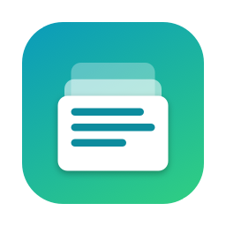
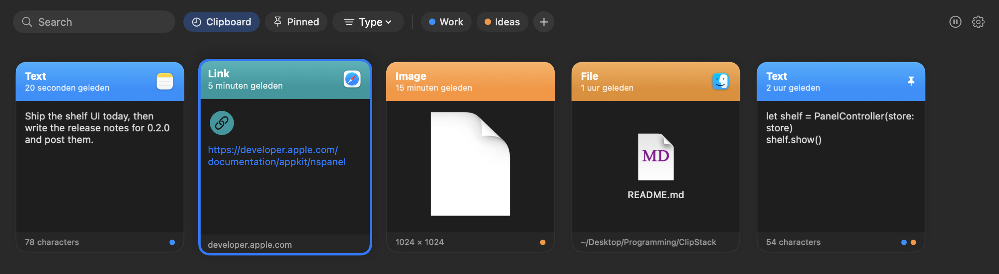
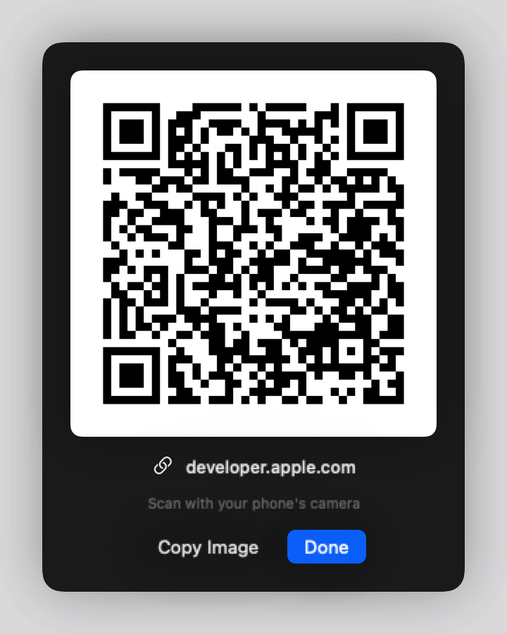

<p align="center">
  
</p>

<h1 align="center">ClipStack</h1>

<p align="center">
  A visual clipboard history for macOS that lives in your menu bar.<br>
  Press ⇧⌘V and everything you copy slides up from the bottom of the screen as cards you can search, sort into categories, paste back, or beam to your phone as a QR code.
</p>

<p align="center">
  <a href="https://github.com/dsomid/ClipStack/releases/latest"></a>
  
  <a href="CHANGELOG.md"></a>
</p>

<p align="center">
  
</p>

## Features

| | |
| --- | --- |
| **Captures everything** | Text, links, images and files, as you copy them |
| **Shelf of cards** | Slides up from the bottom of the screen with a horizontal row of cards: colored headers, source app icon, rich previews of text, links, images and files |
| **Global hotkey** | ⇧⌘V opens the shelf over any app, on the screen your mouse is on |
| **Categories** | Make your own color-coded categories and add any card to one or more of them |
| **Search and filter** | Search all text, links and file names; filter by Text, Links, Images, Files |
| **Keyboard first** | ← → to move between cards, Return to paste, type to search, Esc to close |
| **Click to copy** | Click a card to put it back on the clipboard, or turn on **auto-paste** |
| **Pin** | Pinned items get their own tab; pinned and categorized items are never cleaned up |
| **Instant QR Share** | Hover a link or short text and click the QR button to scan it with your phone |
| **Privacy** | Ignores password managers, plus any apps you add; **Pause** capture; auto-delete after a day, week or month |
| **Settings** | Custom shortcut, history size (100 to 2,500), launch at login |
| **No duplicates** | Copying something again moves it to the top |

<p align="center">
  
</p>

## Install

Requires macOS 14 Sonoma or later. Runs natively on Apple silicon and Intel.

1. Download **`ClipStack-<version>.dmg`** from the [latest release](https://github.com/dsomid/ClipStack/releases/latest).
2. Open the DMG and drag **ClipStack** into **Applications**.
3. Open ClipStack from Applications. A clipboard icon appears in the menu bar; there's no Dock icon.

ClipStack isn't notarized by Apple yet, so macOS blocks the first launch. Open it once, then go to **System Settings → Privacy & Security** and click **Open Anyway**. On macOS 14 you can instead right-click the app and choose **Open**.

Or from Terminal, after copying it to Applications:

```bash
xattr -dr com.apple.quarantine /Applications/ClipStack.app
```

### Auto-paste (optional)

To have ClipStack paste the item into your current app the moment you pick it, turn on **Paste automatically** in **Settings…**, then allow ClipStack under **System Settings → Privacy & Security → Accessibility**. Without it, picking an item just copies it and you press ⌘V yourself.

### Uninstall

Quit ClipStack from its menu, delete it from Applications, and optionally remove its history and settings:

```bash
rm -rf ~/Library/Application\ Support/ClipStack
defaults delete com.omid.clipstack
```

## Usage

| Action | How |
| --- | --- |
| Open the shelf | Press **⇧⌘V** anywhere, or choose **Open ClipStack** from the menu bar icon |
| Move between cards | **←** **→** |
| Copy an item | Click its card, or select it and press **Return** |
| Pin, delete, show QR | Right-click a card |
| Make a category | Click **+** in the top bar and type a name |
| Add to a category | Right-click a card → **Category** |
| Rename, recolor or delete a category | Right-click its tab |
| QR code | Hover a link or short-text card and click the QR button in its corner |
| Close the shelf | **Esc**, or click outside it |
| Change the shortcut | **Settings… → Show history**, click the shortcut and press new keys |
| Stop capturing for a while | Click **⏸** in the shelf, or **Pause Capture** in the menu |

## Build from source

Needs only the Xcode Command Line Tools (`xcode-select --install`); no Xcode project.

```bash
git clone https://github.com/dsomid/ClipStack.git
cd ClipStack
./build.sh
```

This produces `build/ClipStack.app` (universal) and `build/ClipStack-<version>.dmg`. To redraw the icon, run `swift make_icon.swift AppIcon.iconset && iconutil -c icns AppIcon.iconset -o AppIcon.icns`.

`build.sh` has optional signing modes, all set by environment variables:

| Variables | Result |
| --- | --- |
| none | Ad-hoc signed, history stays on this Mac |
| `SIGN_IDENTITY` | Developer ID signed with the hardened runtime |
| `SIGN_IDENTITY` + `PROFILE` | Also enables **iCloud sync** between your Macs |
| + `NOTARY_PROFILE` | Notarizes and staples the DMG |

iCloud sync needs an Apple Developer account: an App ID `com.omid.clipstack` with the iCloud (CloudKit) and Push Notifications capabilities, a container `iCloud.com.omid.clipstack`, and a provisioning profile for it. ClipStack switches sync on by itself when it's signed that way. Copied files sync as paths, so they only open on Macs where the same file exists.

## How it works

- macOS has no clipboard-changed notification, so ClipStack checks `NSPasteboard.general.changeCount` every half second, which costs next to nothing.
- History is a Core Data store in `~/Library/Application Support/ClipStack`, built on `NSPersistentCloudKitContainer` so iCloud sync is a signing change rather than a code change.
- The hotkey uses Carbon's `RegisterEventHotKey`, which needs no Accessibility or Input Monitoring permission.
- The floating panel takes keyboard focus without activating ClipStack, so your app stays frontmost and can receive the paste.
- Copies that apps mark as concealed or transient (how password managers flag secrets) are never saved.

## Version history

See [CHANGELOG.md](CHANGELOG.md), or the [Releases](https://github.com/dsomid/ClipStack/releases) page.
